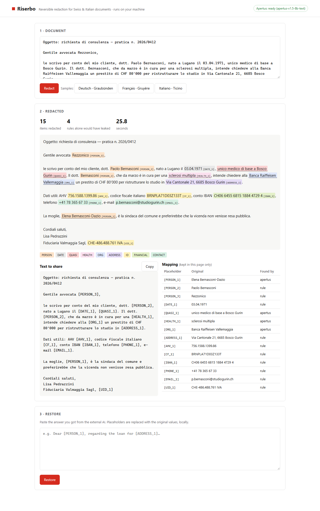

# Riserbo

**Reversible redaction of personal data in Swiss and Italian documents, powered by Apertus and running entirely on your own machine.**

*Riserbo* (Italian: discretion, confidentiality) lets a legal or compliance team use any cloud AI on client documents without the personal data ever leaving the building:

1. Paste a document in Italian, German or French.
2. Riserbo finds the personal data, both **direct** (names, AHV numbers, IBANs, addresses…) and **indirect**: details that identify someone even without a name, like *"l'unico medico di base a Bosco Gurin"*.
3. Every hit becomes a placeholder (`[PERSON_1]`, `[AHV_1]`, `[QUASI_1]`). Share the redacted text with any AI.
4. Paste the AI's answer back and Riserbo restores the real values locally.

Apertus 1.5 8B runs in its own Docker container on an internal network with **no internet access**. Riserbo is designed for **on-premise / air-gapped** deployment (Hack Apertus target architecture a + b).



## Results

On a synthetic test set of 60 Swiss/Italian documents in three languages (`make eval`), Riserbo leaves **13.2%** of personal-data characters visible, against **58.2%** for rules alone and **29.1%** for the rizzo-pii-0.3B tagger. It is the only setup that finds indirect identifiers (recall 56.7%) and most health data (81.7%).

| Setup | Leak rate ↓ | Entity recall | Precision | s/doc |
|---|---|---|---|---|
| Rules only | 58.2% | 41.8% | 100.0% | 0.0 |
| Apertus only | 25.4% | 72.7% | 93.9% | 12.88 |
| **Riserbo (rules + Apertus)** | 13.2% | 89.1% | 92.7% | 12.88 |
| rizzo-pii-0.3B (reference) | 29.1% | 74.2% | 84.5% | 0.19 |
| Rules + rizzo-pii | 26.0% | 77.4% | 80.3% | 0.19 |

60 synthetic documents (20 IT, 20 DE, 20 FR), 594 gold items, Apertus 1.5 8B Q4_K_M, temperature 0, 0 failed model calls. s/doc measured on a GTX 1660 Super (6 GB) with the CPU shared by other workloads. Full breakdown in the [technical report](track_2b/technical_report.md#5-evaluation).

## Try it

Requirements: Docker with Compose, ~8 GB free RAM, ~6 GB disk. No GPU needed.

```bash
cd track_2b
make run          # downloads the model once (~5 GB), then starts everything
# open http://localhost:8080 and click a sample document
```

Already running Apertus elsewhere (LM Studio, vLLM, a sovereign Swiss cloud endpoint)? Point the app at it:

```bash
LLM_BASE_URL=http://host.docker.internal:1234/v1 LLM_NAME=apertus-v1.5-8b-text make run-app
```

Reproduce the evaluation with `make eval`, and run the tests with `make test`.

## How it works


- **Rules** (`detectors.py`) find identifiers that have a checksum or a strict format: Swiss AHV/AVS (EAN-13), IBAN (mod-97), Swiss UID (mod-11), Italian codice fiscale and partita IVA, payment cards (Luhn), e-mails, phones, dates of birth, postal addresses, and names after a title. A number is only redacted when its checksum is valid, so invoice numbers and amounts stay readable.
- **Apertus** (`llm.py`) runs two focused passes on each ~500-character chunk. The *identity* pass finds people, organisations, addresses and reference numbers. The *context* pass finds health data and **quasi-identifiers**. Output is constrained by a JSON schema, and every span must appear verbatim in the document (hallucination guard). Surnames are propagated, so "dott. Bernasconi" is hidden once "Paolo Bernasconi" is found.
- **Merge and placeholders** (`pipeline.py`): checksum rules win, otherwise the longer span wins. The same value always gets the same placeholder.
- **Restore** (`restore.py`): swaps placeholders back. The mapping lives only in the browser page and is never written to disk.

Details, evaluation and limitations: [`track_2b/technical_report.md`](track_2b/technical_report.md).

## Repository layout

```
track_2b/            Hack Apertus project root (template layout)
  src/riserbo/       app, detectors, Apertus client, evaluation
  data/samples/      synthetic demo documents (IT/DE/FR)
  data/eval/         synthetic test set + results
  tests/             pytest suite
  docs/              diagram and screenshots
devpost/             planning docs written with the Devpost Learn skill pack (scope, PRD, spec, checklist)
.agents/skills/      the Devpost Learn skill pack used to plan and build this project
```

## Credits and licences

- Code: Apache-2.0 (see `LICENSE`). Documentation: CC-BY-4.0. Synthetic datasets: CDLA-Permissive-2.0.
- Model: [swiss-ai/Apertus-v1.5-8B](https://huggingface.co/swiss-ai/Apertus-v1.5-8B) (Apache-2.0 + Apertus Acceptable Use Policy), via the text-only conversion [andreasmartin/apertus-v1.5-8b-text](https://huggingface.co/andreasmartin/apertus-v1.5-8b-text) and the GGUF quantisation [Colby/apertus-v1.5-8b-text-Q4_K_M-GGUF](https://huggingface.co/Colby/apertus-v1.5-8b-text-Q4_K_M-GGUF).
- Inspiration: [rizzo-pii](https://github.com/Rizzo-AI-Academy/rizzo-pii) by Simone Rizzo / Rizzo AI Academy (MIT), a local, reversible PII anonymiser for Italian legal text. Riserbo is a new codebase that does not copy rizzo-pii's code. It uses the rizzo-pii-0.3B model only as an optional baseline in the evaluation.
- Serving: [llama.cpp](https://github.com/ggml-org/llama.cpp) (MIT).
- All names, identifiers and documents in this repository are synthetic. Any resemblance to real people is coincidental.
