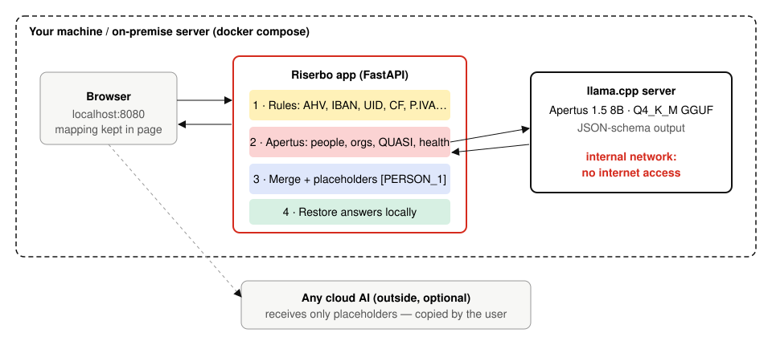

# Technical report — Riserbo

Reversible redaction of personal data in Swiss and Italian documents, powered by Apertus and running entirely on your own machine.

- **Track:** Track 2B — Own project
- **Event:** Online
- **Team:** Riserbo — Alfredo de Candia (solo)
- **Code:** https://github.com/AliceMessi/riserbo
- **Demo:** `<!-- VIDEO -->`

## 1. Summary

Swiss lawyers, fiduciaries and compliance teams want to use cloud AI on client files, but the Federal Act on Data Protection (revFADP) and professional secrecy (Art. 321 SCC) make sending client data abroad risky. Rule-based anonymisers catch IBANs and tax numbers but miss names in free text. Small taggers catch names but miss **indirect identifiers**: a person recognisable without a name, such as *"l'unico medico di base a Bosco Gurin"* or *"die Gemeindepräsidentin von Obersaxen"*. Riserbo combines checksum-validated rules for Swiss and Italian identifiers with **Apertus 1.5 8B**, which reasons about context in Italian, German and French. Every hit becomes a placeholder; after an external AI has answered, the originals are restored locally. Apertus runs in Docker on an internal network with no internet access. On a 60-document synthetic test set in three languages, Riserbo leaves 13.2% of personal-data characters visible, against 58.2% for rules alone and 29.1% for the rizzo-pii-0.3B tagger, and it is the only setup that finds indirect identifiers.

## 2. Architecture

| Component | Role | Runs where |
|---|---|---|
| `detectors.py` | Regex candidates plus validation: AHV/AVS (EAN-13), IBAN (ISO 13616 mod-97), Swiss UID (mod-11), codice fiscale (check character, omocodia), partita IVA (Luhn, needs VAT context), cards (Luhn), e-mail, phone, IPv4, date of birth (with context), postal address, names after a title | app container |
| `llm.py` | Two Apertus passes per ~500-character chunk, JSON-schema constrained; verbatim span location; surname propagation | app → llama.cpp |
| `pipeline.py` | Merge (checksum rules first, then longest span); stable placeholders per distinct value; persons numbered in reading order | app container |
| `restore.py` | Placeholder → original, unknown tokens reported | app container |
| `server.py` + `static/index.html` | FastAPI JSON API and a single page; no persistence | app container |
| llama.cpp server | OpenAI-compatible inference of Apertus GGUF, grammar-constrained JSON | `llm` container, internal network |

### Target architecture (mandatory)

Riserbo is deployable **(a) on-premise** and **(b) air-gapped**.

- `docker-compose.yml` places the model server on a network declared `internal: true`, so it has no route to the internet. Only the app is published on `localhost:8080`, and the app makes no outbound calls of its own.
- **Build time** (one-off, can be done on a connected machine and copied): Docker images `python:3.11-slim` and `ghcr.io/ggml-org/llama.cpp:server` (pinned by digest), Python wheels from `requirements.txt`, and the 5.06 GB GGUF from Hugging Face (`make model`).
- **Runtime:** no external dependency. The mapping between placeholders and originals stays in the browser page and is never written to disk.
- **(c) Sovereign Swiss cloud** also works: set `LLM_BASE_URL` to an Apertus endpoint hosted in Switzerland. The bundled setup does not require one.

## 3. Use of Apertus

- **Model:** `swiss-ai/Apertus-v1.5-8B`, text-only conversion `andreasmartin/apertus-v1.5-8b-text`, quantised `Colby/apertus-v1.5-8b-text-Q4_K_M-GGUF` (4.7 GiB in memory).
- **How it is used:** inference, i.e. structured information extraction. No fine-tuning.
- **Where it runs:** local weights served by llama.cpp on CPU in Docker. During development it ran in LM Studio on a 6 GB GTX 1660 Super with the same OpenAI-compatible API.
- **Prompting:** two focused passes instead of one prompt. The *identity* pass looks for PERSON, ORG, ADDRESS and ID; the *context* pass looks for HEALTH and QUASI. Each pass has a system prompt and two or three few-shot examples in IT/DE/FR. Few-shot examples use places and names that appear neither in the demo samples nor in the test set.
- **Constrained output:** `response_format: json_schema` with `minItems: 1` and a `NONE` sentinel type. Without the sentinel, greedy decoding sometimes closed the list immediately (`{"entities": []}`) on a chunk that clearly contained names. With it, repeated runs gave identical output. Apertus 1.5 prefers to reason before answering, and forcing JSON first made the empty-list failure mode common.
- **Guards:** each returned span must be found verbatim in the document (case and whitespace tolerant, word boundaries), otherwise it is dropped. This prevents hallucinated names from being "redacted" or leaking into the mapping. Addresses without a digit (a town on its own) are discarded.
- **Settings:** temperature 0, max 1000 output tokens per call, context 8192.

## 4. Data

- **Demo samples** (`data/samples/`): three synthetic letters (Ticino IT, Graubünden DE, Gruyère FR) written for this project.
- **Test set** (`data/eval/riserbo_eval_v1.jsonl`): 60 synthetic documents (20 per language) with 594 gold spans, generated by `python -m riserbo.eval.generate --seed 2026`, which is deterministic. Templates mimic legal letters and meeting minutes. Slots are filled with fake names, organisations, addresses, checksum-valid AHV/IBAN/UID/CF numbers, health details and indirect identifiers. Each document also contains **distractors that must not be redacted**: 11-digit invoice numbers, amounts, case numbers, meeting dates, courts and public offices.
- **Licences:** both datasets are created by us, contain no real personal data and are released under CDLA-Permissive-2.0. Any resemblance of a synthetic name to a real person is coincidental.
- No data from human subjects was collected.

## 5. Evaluation

**Metrics.** *Leak rate* is the share of gold personal-data characters still visible after redaction (lower is better). *Entity recall* is the share of gold items at least half covered. *Precision* is the share of redactions that overlap gold personal data, so over-redaction lowers it. *s/doc* is the processing time per document.

**Setups.** `rules`: deterministic detectors only. `apertus`: model only. `rules+apertus`: Riserbo. `rizzo-pii-0.3B`: the MIT rizzo-pii tagger (mmBERT, 22 Italian legal PII types) via `transformers`, run on the same documents as a reference point. `rules+rizzo`: our rules merged with rizzo-pii.

60 synthetic documents (20 IT, 20 DE, 20 FR), 594 gold items, Apertus 1.5 8B Q4_K_M, temperature 0, 0 failed model calls. s/doc measured on a GTX 1660 Super (6 GB) with the CPU shared by other workloads.

| Setup | Leak rate ↓ | Entity recall | Precision | s/doc |
|---|---|---|---|---|
| Rules only | 58.2% | 41.8% | 100.0% | 0.0 |
| Apertus only | 25.4% | 72.7% | 93.9% | 12.88 |
| **Riserbo (rules + Apertus)** | 13.2% | 89.1% | 92.7% | 12.88 |
| rizzo-pii-0.3B (reference) | 29.1% | 74.2% | 84.5% | 0.19 |
| Rules + rizzo-pii | 26.0% | 77.4% | 80.3% | 0.19 |

| Recall by type | PERSON | ORG | ADDRESS | ID | CONTACT | DATE | HEALTH | QUASI |
|---|---|---|---|---|---|---|---|---|
| Rules only | 10.0% | 0.0% | 93.3% | 100.0% | 100.0% | 100.0% | 0.0% | 0.0% |
| Apertus only | 85.0% | 83.3% | 96.7% | 84.9% | 16.7% | 0.0% | 81.7% | 56.7% |
| **Riserbo (rules + Apertus)** | 90.0% | 83.3% | 100.0% | 100.0% | 100.0% | 100.0% | 81.7% | 56.7% |
| rizzo-pii-0.3B (reference) | 98.9% | 78.3% | 100.0% | 79.6% | 100.0% | 100.0% | 1.7% | 0.0% |
| Rules + rizzo-pii | 98.9% | 78.3% | 100.0% | 100.0% | 100.0% | 100.0% | 1.7% | 0.0% |

| Leak rate by language | IT | DE | FR |
|---|---|---|---|
| Rules only | 62.8% | 56.2% | 55.4% |
| Apertus only | 20.3% | 31.6% | 24.9% |
| **Riserbo (rules + Apertus)** | 13.5% | 16.6% | 9.7% |
| rizzo-pii-0.3B (reference) | 29.4% | 31.9% | 26.3% |
| Rules + rizzo-pii | 24.8% | 28.2% | 25.4% |

**Findings.**
- Riserbo cuts the leak rate from 58.2% (rules) to **13.2%**, and stays below 17% in all three languages. Precision stays at 92.7%: about 7 in 100 redactions cover text that is not personal data (over-redaction, which the PRD prefers to leaks).
- **Apertus is what finds context.** Only the Apertus setups recover quasi-identifiers (56.7%) and health data (81.7%); rizzo-pii scores 0.0% and 1.7%, because these are not in its tag set.
- **Rules and Apertus complement each other.** Apertus alone misses most phone numbers, e-mails and dates (which the prompt tells it to ignore), and the rules have no notion of context. Merged, each covers the other's blind spot.
- **Honest weak spot.** rizzo-pii is better at plain person names (98.9% vs 90.0%) and about 70× faster. On the three demo letters, the names the 8B model skipped were in greeting and signature lines. A natural next step is an ensemble: rizzo-pii or a distilled tagger for names, Apertus for context.
- Quasi-identifier recall (56.7%) is the clearest room for improvement; per-item predictions are not stored by the scorer, so the failure analysis is left to the next iteration.

## 6. Limitations

- **Synthetic test set.** Templates are regular and shorter than real files. Real documents (OCR noise, tables, long contracts) will score lower. The set measures relative differences between setups, not absolute performance on client files.
- **Quasi-identifiers are subjective.** The gold set marks one quasi-identifier per document. Whether a phrase identifies someone depends on the reader's knowledge.
- **Model size.** An 8B model at 4 bits misses some names in signatures and greeting lines. The title-plus-surname rule and surname propagation compensate partly. A 70B model, or a second verification pass, would likely help but needs more hardware.
- **CPU speed.** On CPU inside Docker, a one-page document takes about a minute; with a consumer GPU, 15–25 seconds.
- **Scope.** Plain text only (no PDF/DOCX). Romansh and Swiss-German dialects are not evaluated. Riserbo is an assistant, not a legal guarantee of anonymity; the user reviews the result.

## 7. Reproducibility

- Hardware used for the reported numbers: Windows 11, 16 GB RAM, NVIDIA GTX 1660 Super 6 GB; Apertus served by LM Studio (llama.cpp backend), context 8192, 1 parallel slot, temperature 0.
- `make run` from `track_2b/` downloads the model and starts both containers. `make eval` reproduces the table against the running model server (`data/eval/results.json`). `make test` runs the unit tests: checksum cases, placeholder consistency, merge rules, hallucination guard and round-trip restore.
- Test set: `python -m riserbo.eval.generate --seed 2026`; MD5 of the committed file `edd43acad366f9fb018f2fcd5d1a2414`.
- rizzo-pii baseline: `pip install torch transformers` then `python -m riserbo.eval.run --rizzo`.

## 8. Next steps

- Distil Apertus's judgements into a small, fast tagger (fine-tuning on Apertus-labelled Swiss documents) for CPU-only offices.
- PDF/DOCX import with true redaction of the output file; folder batch mode.
- Romansh and Swiss-German test sets with native speakers; evaluation on real, consented documents with a partner law firm.
- A second "verifier" pass where Apertus re-reads the redacted text and flags anything still identifying.

## License

Code: Apache-2.0. This report and other documentation: CC-BY-4.0. Datasets: CDLA-Permissive-2.0.

## References

- Apertus: Democratizing Open and Compliant LLMs, arXiv:2509.14233. https://huggingface.co/swiss-ai/Apertus-v1.5-8B
- llama.cpp server. https://github.com/ggml-org/llama.cpp
- rizzo-pii, Simone Rizzo / Rizzo AI Academy (MIT). https://github.com/Rizzo-AI-Academy/rizzo-pii
- Swiss AHV number format (EAN-13 check digit), Federal Social Insurance Office. Swiss UID register, Federal Statistical Office.
- Federal Act on Data Protection (revFADP), SR 235.1.
